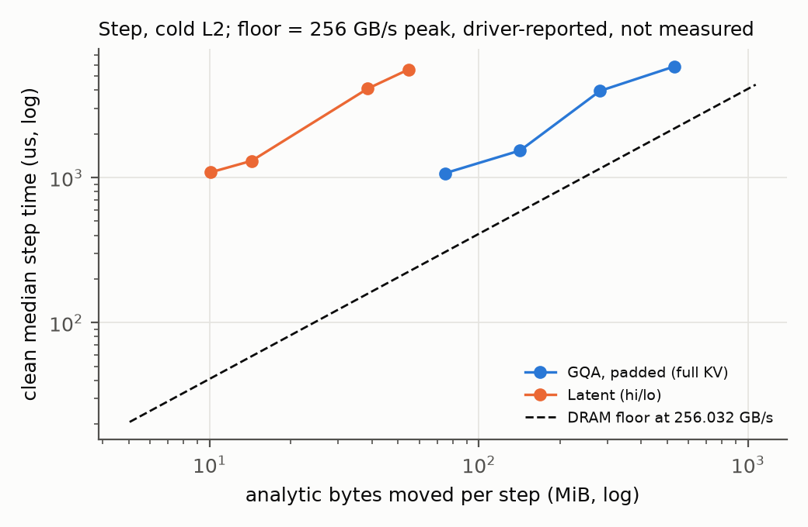

<!--
Redraft notes (remove before submission):
- Claim tags kept so scripts/paper/assemble_paper.py and check_numbers.py still work:
  [M:key] MEASURED (evidence file in the artifact README), [S:key] SOURCE, [H] HYPOTHESIS.
- Every result is from one laptop RTX 4060 under WSL2, not a cloud result.
- Names: "GQA-pad" = padded A3, "GQA-unpad" = unpadded A3, "Latent" = C3 accurate (hi/lo),
  "Latent-fast" = C3 fast, "Single" = E3, "Step" = E4. Old names stay in the artifact README.
- Tables are included from paper/generated/ (make_tables.py emits the new names); assemble_paper.py inlines them.
- Corrections ledger and evidence keys: paper/ARTIFACT_README.md.
-->

# Introduction

Each decode step of a large language model reads the whole KV cache of every sequence to produce one token. With small batches the step does little arithmetic per byte, so a cache that stores fewer bytes per token should make decode proportionally faster. Multi-head latent attention (MLA) [2] is the most prominent such format: it caches one low-dimensional latent vector per token, shared by all heads, and projects queries into the latent space at decode time. Conversions from GQA models to MLA [5, 6] are motivated in part by this expected decode speedup.

We test the expectation directly. We wrote a paged latent decode kernel and a paged GQA decode kernel in the same tile language (cuTile [15]), gave both the same split-K structure, block table and reduction, checked both against the same exact and matched-rounding references, and timed both under one protocol with 95 % confidence intervals. We expected the time ratio to follow the byte ratio. It does not.

**Thesis.** Across the four configurations that support a claim, the latent kernel moves 7.3 to 13.2 times fewer analytic bytes than a padded GQA baseline, yet its time per step ranges from 13.5 % less to 3.0 % more [M:timing]. Compression is not the same as speedup on this GPU, and measuring even that required fixing three traps in the measurement itself.

**Contributions.**

1. *A clock-validity failure mode and an exclusion protocol for hosts that cannot lock clocks* (Section 4). Under WSL2, a 20.8 ms NVML query (measured idle, one driver) after every sample left 73 % of one process's samples at 210 MHz, up to about 16 times slower, and a modal-clock rule passed that process. A 10-iteration check of the first fix passed where the 50-iteration run collapsed. Idle clocks distorting short kernels are known [10, 11]; these three specifics we have not found reported (Section 8). The protocol that resulted classifies every process before any ratio is computed, and every ratio in the paper carries a 95 % hierarchical-bootstrap confidence interval.
2. *Numerics* (Section 5). On one heavy-tailed dataset the latent kernel's large error comes from FP16 rounding of the projected query, not from accumulation. Splitting the projected query into FP16 high and low parts fixes it at twice the score MMAs and, at the one size where both modes were timed, 1.7 to 5.2 % more time, with confidence intervals that include zero cost.
3. *A fair GQA baseline under cuTile's tensor-core rules* (Section 6, the baseline). In our probes only 16-row tiles with at least 512 outputs got tensor-core instructions, so GQA needs query-row padding. Without padding GQA takes only about 3.6 % less time at one configuration, and the latent kernel's win holds against both baselines there.
4. *A bounded, mixed result* (Section 6). Of 11 configurations, the latent kernel is faster in two, slower in one, not shown to differ in one, and seven are descriptive only. Achieved bandwidth shows that neither kernel is limited by DRAM bandwidth at these sizes.

# Background

## Why decode should be memory-bound

At decode time each query head attends over all cached tokens of its sequence: one score per token and one weighted sum of values. For one GQA KV head with head dimension 64 serving 4 query heads, each cached token costs 256 bytes (FP16 K and V) and about 1024 FLOPs (512 multiply-adds for scores and values), about 4 FLOP per byte. At that arithmetic intensity decode is expected to be memory-bound; this paper tests that expectation. If time follows bytes, a cache with 16 times fewer bytes per token should approach a 16 times shorter step.

## GQA and latent caches

Grouped-query attention [3] shares each K/V head among a group of query heads; in our shape, 16 query heads share 4 KV heads (group size 4), and each KV head caches a 64-dimensional key and value per token. A latent cache [2] stores one 32-dimensional vector c per token for all heads. At decode time each query q is projected once into the latent space, q′ = q P^K, scores are q′ cᵀ, the weighted sum is taken over c, and the result is projected back with P^V. In our shape the latent cache holds 64 bytes per token against GQA's 1024 bytes, 16 times fewer (Figure 1). Our kernels use no rotary position embedding, so the decoupled-RoPE key of production MLA is not modelled.

## Paging and split-K

Paged attention [1] stores the cache in fixed-size blocks reached through a per-sequence block table, which removes fragmentation but does not change bytes per token. Split-K decode [14] divides a long sequence among several thread blocks (CTAs), each producing an unnormalized partial result, and a reduce kernel merges them with a log-sum-exp. Both our kernels use this structure.

## The platform

We use one laptop RTX 4060 (Ada, sm_89, 8 GB) under WSL2; the driver reports 24 SMs, a 32 MiB L2 and a 128-bit memory bus at 8001 MHz [M:dev]. Tensor-core use is decided by the cuTile compiler, not by the kernel author (Section 6, the baseline). Under WSL2 GPU clocks cannot be locked, which is the standard defence against clock variation in GPU benchmarking [12]. We therefore validate every process from measured clocks instead (Section 4). Nothing in this paper is a cloud or data-centre result.

# Kernels and benchmarks

**Kernels** [S:kern]. Both kernels are written in cuTile through the Rust crates `cutile` and `cutile-compiler`, version 0.2.0 (pinned in `Cargo.toml`, locked from crates.io), with FP16 storage and FP32 accumulation. Both walk the block table in two-block steps of 32 tokens, run an online softmax, write partials, and merge them in a log-sum-exp reduce; both run at most 128 two-block steps per CTA, and the host validates tables and alignment before every launch. Figure 1 shows the dataflow.

- **GQA-pad** (baseline, declared before any timing). One CTA per (split, KV head), covering that head's 4 query heads, zero-padded to 16 rows so both matrix products reach tensor cores. **GQA-unpad** is the same kernel without padding, used in a sensitivity run.
- **Latent** (primary latent kernel). One CTA per split, covering all 16 query heads, which share one latent tile. It computes q′ = q P^K once per CTA in FP32, represents q′ as an FP16 high part plus an FP16 low part, and issues two score MMAs into one FP32 accumulator. The reduce applies P^V once per head. **Latent-fast** uses a single FP16 q′ (Section 5).

![Dataflow of the two kernels at our shape (16 query heads, 4 KV heads, head dimension 64, latent dimension 32, 16-token blocks). (a) GQA-pad reads K and V of one KV head per CTA, 1024 B per token over all heads, and pads 4 query rows to 16. (b) Latent reads one shared latent vector per token, 64 B, for all 16 heads. Static HMMA and register counts are from compile-only SASS [M:sass].](../reports/local_4060_20261101/figures/fig_dataflow.png)

**Benchmarks** [S:e4]. *Single* times one decode step (split and reduce) for one sequence of length N without flushing L2, so its working set stays L2-resident across iterations. *Step* times all layers of one decode step for a batch of B sequences of length up to N, with deterministic unequal active lengths; the harness uses `max(4, ceil(65536 / (B*N)))` layers, so 4 at every claim-eligible configuration and up to 64 at B1·N1024. Each layer has its own pool, each sequence owns a disjoint slice of it, and the harness writes a 64 MiB buffer before every layer to flush L2, so every block is read cold once per layer. Bytes are *analytic*, counted from the access pattern, including projections, partials and block tables; they are not measured DRAM traffic. Table 1 gives the setup.

<!-- include: generated/tab_setup.md -->

*Table 1: Setup. The shape is synthetic and model-shaped, not a production model.*

**Timing protocol** [S:rules]. Each process checks correctness against a CPU reference, runs warm-up iterations and a clock warm-up whose second-half modal SM clock becomes the process's *reference clock*, then 50 timed iterations with the kernels interleaved in rotating order. The estimate for a configuration is the geometric mean over clean processes of the per-process ratio of median times, with a 95 % hierarchical-bootstrap confidence interval (CI). A claim needs at least 5 clean processes: *shown* if the CI excludes 1.0, *not shown* if it includes 1.0. Parity would need an equivalence test, which we did not run, so we never claim parity. Which processes count was fixed in writing before the data it applies to.

# Measurement validity: three traps

A Step layer at B=1, N=1024 takes about 24 µs at the reference clock [M:void]. Any host-side pause between such kernels lets the GPU fall to an idle performance state, and it does not return to its reference clock at once [11]. We hit this three times in different forms. Figure 2 shows one process from each stage and Table 2 the per-process clock statistics; none of these processes is used for any ratio.

![Clock traces of single processes, in time order: SM clock (top) and per-layer time (bottom, log scale). (a) Before any fix: the clock steps down from 1890 MHz to 210 MHz within about 180 samples and stays there; 73 % of samples are at 210 MHz, but the modal clock is also 210 MHz, so a modal-clock check passes the process. (b) Fix 1 with short re-warm bursts: the clock oscillates between 315 and 1545 MHz against a 1890 MHz reference. (c) Fix 2: the clock stays within 1 % of 2595 MHz; the slow first ~30 samples are a start-of-timing transient that was not excluded. Laptop RTX 4060, WSL2.](../reports/local_4060_20261101/figures/fig_clock_traces.png)

<!-- include: generated/tab_clock_validity.md -->

*Table 2: Clock validity of instrument-check processes. In-band: share of in-process SM clock reads within 95 % of the process's reference clock [M:checks].*

## Trap 1: slow output writes

An earlier harness, for an older pair of unsplit kernels, wrote result files to a slow cloud-synchronized Windows path during timing, so the GPU idled at low clocks between kernels [M:t1]. Those ratios were voided. The harness used for every ratio in this paper never writes output during timing [S:harness].

## Trap 2: a 20 ms telemetry call

The harness read NVML clocks, temperature and clock-event-reason bits after every timed sample. Under WSL2 the reasons query is slow. Re-measured separately (50 back-to-back calls, GPU idle, 62 C, driver 617.42), it took a median of 20.8 ms and at most 29.0 ms, against 0.03 to 0.15 ms for the clock and temperature reads [M:nvml]. Called after every sample, it left the GPU idle for several hundred times longer than the kernel it had just timed.

In the dry run before any fix, 73 % of Step layer samples were at exactly 210 MHz and the in-band fraction was 0.09; the median GQA-pad layer took 378 µs against 24 µs at the reference clock, about 16 times slower in this process [M:void] (Figure 2a). Our original validity rule compared each clock read with the process's *modal* clock, which was itself 210 MHz, so the process passed. The dry run is void. The trap depends on kernel length: with the per-sample query still in place, a Single process at N=1024 had an in-band fraction of 0.29, while one at N=8192, whose kernels are longer, stayed at 1.00 (Table 2).

## Trap 3: a short check that passed

Fix 1 read the reason bits once per step and added an untimed re-warm of short bursts, each followed by a synchronization. A 10-iteration check at B1·N1024 was fully in band. The 50-iteration campaign run then collapsed: across its five processes the in-band fraction was 0.002 to 0.096 [M:checks] (Figure 2b), and it is reported as an instrument failure. [H] Synchronizing after every short burst kept the GPU's duty cycle low, so the clock never ramped. Fix 2 enqueues about 20 ms of work back to back before one synchronization, and repeats until the clock is within 95 % of the reference or 500 ms pass. Checked at full length before any ratio was computed, it gave in-band fractions of 0.99 and 1.00 [M:checks] (Figure 2c). All primary Step data use fix 2; the primary Single data use fix 1, and the two are never pooled.

## The resulting protocol

Beyond the timing protocol of Section 3 [S:rules], a process is **THROTTLED** if any SM clock read is more than 5 % below its modal clock or any thermal or hardware-slowdown bit is set; if its modal clock is more than 5 % below its own reference clock (this closes the Trap 2 gap); or if its reference is below 0.95 times the best reference in the configuration. The in-band fraction is reported for every process as an instrument check, not a gate. Output from a broken harness state is **VOID**, every harness change is checked at full length first, and each block runs **once**: a configuration with too few clean processes is reported as such, not re-run until it passes.

# Numerics

Speed comparisons are fair only between kernels of comparable error. We compare each kernel with an *exact* reference (FP32 arithmetic on the FP16-stored cache) and with a *matched-rounding* reference that applies the kernel's own FP16 roundings and step structure but accumulates in FP64 [S:kern]. Total error is kernel against exact; kernel-attributable error is kernel against matched-rounding. Figure 3 and Table 3 give the results.

**FP16 q′ is the cause, not accumulation.** On heavy-tailed inputs Latent-fast reaches a max error of 4.182e-3 at N=8192 [M:scale], above our 3e-3 gate. A CPU emulation of the same dataset (one dataset, one N) reproduces it and isolates the source (Figure 3b): with all-FP32 arithmetic the error is 1.907e-05; rounding only P to FP16 gives 1.426e-03; rounding only q′ to FP16 gives 4.163e-03, the same as rounding both [M:emu]. P was already accumulated in FP32, so a wider accumulator would not help. [H] Heavy-tailed inputs produce large scores, so the 2^-11 relative rounding of q′ shifts the probabilities of the dominant tokens.

**A hi/lo split fixes it.** Latent stores q′ as an FP16 high part plus an FP16 low part and issues two score MMAs into one FP32 accumulator. Its heavy-tailed max error at N=8192 falls to 1.088e-3 [M:scale], comparable to GQA-pad (1.336e-3), which has the same FP16-P term; mean error falls from 5.318e-4 to 1.748e-4. In the compiled code the split doubles the score MMAs (8 to 16 per CTA per step, against 8 PV MMAs), so total MMAs per step rise by 50 %; registers stay at 95 and loads are unchanged [M:sass]. Its run-time cost was measured at one size, Single N=8192: Latent / Latent-fast is 1.052 [0.999, 1.089] in the primary run and 1.017 [0.974, 1.057] in the sensitivity run, 5 clean processes each [M:fastacc]. Both CIs include 1.0, so the cost (point estimates 5.2 % and 1.7 %) is not shown to differ from zero. This is a secondary analysis, computed after the runs.

**Kernel error is small and separate.** Kernel-attributable error is at most 4.072e-4 for every kernel and input [M:scale]; the rounding choices, not the kernels' arithmetic, set the total. With the plan bounded at 128 two-block steps per CTA, uniform-input error stays flat from N=4096 to 32768.

<!-- include: generated/tab_numerics_scale.md -->

*Table 3: Max |error|, total / kernel-attributable, GPU correctness only [M:scale].*

# Results

## Main result

Table 4 gives every configuration of the primary dataset, including the descriptive ones, and Figure 4 plots the claim-eligible ratios against the GQA-pad working set per layer.

<!-- include: generated/tab_timing.md -->

*Table 4: Primary results [M:timing]. Process counts: clean / THROTTLED / hot start. Median µs per step over clean processes (Step: all layers, 4 at every claim-eligible configuration; Single: split and reduce for one sequence). Ratio: geometric mean of per-process ratios of medians. Single and Step rows come from different harness versions and are never pooled.*

Four configurations are claim-eligible. The latent kernel takes 10.7 % less time at Single N=8192, 0.893 [0.860, 0.936]; every process there had an in-band fraction of 1.0, and a preliminary run taken with one extra application open agrees, 0.888 [0.869, 0.914] [M:prelim]. It takes 13.5 % less time at Step B8·N8192, 0.865 [0.842, 0.916], and 3.0 % more at Step B32·N4096, 1.030 [1.009, 1.051]. At Step B32·N8192 it is 0.972 [0.915, 1.029]: no difference shown and no parity claimed. The other seven configurations, all at B=1 or N=1024 plus B8·N4096, had fewer than 5 clean processes and are descriptive only.

![Time ratio, Latent / GQA-pad, with 95 % CI against GQA-pad working set per layer. Filled: claim-eligible; hollow: fewer than 5 clean processes; configurations with no clean process have no point. Dotted: the ratio if both kernels ran at the same achieved bandwidth (1 / byte ratio). The L2 line (32 MiB, reported by the driver [M:dev]) is a reference only, since Step flushes L2 before each layer.](../reports/local_4060_20261101/figures/fig_regime_map.png)

## Where the time goes

If both kernels were limited by DRAM bandwidth, the ratio would sit near the reciprocal of the byte ratio, the dotted line in Figure 4. Every point is far above it. Achieved analytic bandwidth (Table 5, Figure 5) shows why: GQA-pad reaches 60.5 to 97.1 GB/s and Latent 5.2 to 11.5 GB/s, against a theoretical peak of 256.0 GB/s, computed as 2 × memory clock × bus width / 8 from the driver-reported 8001 MHz and 128 bits [M:dev]; we did not measure DRAM bandwidth. Neither kernel is near the bandwidth roof, and Latent is an order of magnitude further from it, so the bytes it saves are not the bytes that set its time.

<!-- include: generated/tab_bandwidth.md -->

*Table 5: Analytic bytes and achieved bandwidth for configurations with clean processes [M:timing]. GB/s is analytic bytes divided by the clean median time, not measured DRAM traffic. Across all 11 configurations the byte ratio is 3.5 to 13.2.*

[H] At these sizes the latent kernel is limited by something other than bytes. One candidate is parallelism: GQA-pad launches one CTA per (split, KV head) and Latent one per split, so Latent has a quarter as many CTAs to fill the GPU, and the two kernels fill it differently as B and N change. Others are launch overhead and the per-CTA projection. We did not test any of these; a profiler run is the next step (Section 7).

## The baseline: why padding, and what it costs

cuTile decides whether an `mma` lowers to tensor-core HMMA instructions. In our compile-only SASS probes (sm_89, 4 warps per CTA), only 16-row tiles with at least 512 outputs got HMMA [M:sass]. GQA-unpad has 4 query rows per KV head and compiled to no HMMA; widening its step to 512 score outputs still gave none and added 616 bytes of stack spills, and a 16 × 16 tile (256 outputs) also fell back. Padding to 16 rows gave 40 static HMMA without spills, at 4 times the multiply-adds (Table 6). Only 4 and 16 rows and 256 and 512 outputs were tested, so the threshold between them is not established. FlashDecoding++ [17] pads for a similar reason: it pads the M dimension of flat decode GEMMs to 8, matching tensor-core tile shapes, rather than the 64 of previous designs.

<!-- include: generated/tab_kernels.md -->

*Table 6: Compile-only SASS: static HMMA count, registers, stack bytes and theoretical occupancy [M:sass].*

Is GQA-pad a strawman? A secondary run, declared before its data [S:rules], added GQA-unpad at one configuration, Single N=8192 (Table 7). GQA-unpad takes only about 3.6 % less time than GQA-pad, 0.964 [0.928, 0.989], despite a quarter of the multiply-adds, and Latent is still faster against it, 0.924 [0.888, 0.971] [M:sens]. The Single N=8192 win holds against both baselines, with about 7.6 % instead of about 11 % less time. Step was not repeated with GQA-unpad.

<!-- include: generated/tab_sensitivity.md -->

*Table 7: Sensitivity run, 5 clean processes per ratio, own harness version [M:sens].*

## What Step can and cannot show

Because Step flushes L2 before every layer [S:e4], *L2 capacity is not an axis of this benchmark*, and the hypothesis that the latent cache wins once the working set outgrows L2 is not tested. Single against Step contrasts warm and cold caches, not sizes. With three claim-eligible Step points, no trend in B or N can be established.

# Limitations and what we do not claim

- **One laptop GPU under WSL2.** No second GPU, no native Linux host, no data-centre part. Clocks cannot be locked; every exclusion comes from measured clocks, and 7 of 11 configurations lost too many processes. No B=1 result exists: B=1 processes ran mostly at 2595 MHz with some reads near 1890 MHz, and the modal-clock rule excluded them. Loosening the rule after seeing the data would be post hoc, so we did not.
- **No profiler data.** Bytes are analytic, and the 256 GB/s peak is computed from driver-reported values, not measured. We have no Nsight profile (performance-counter access is denied under WSL2 on this host, `ERR_NVGPUCTRPERM` [M:ncu]) and no measured DRAM traffic, so the explanation in Section 6 (where the time goes) is a hypothesis.
- **Narrow grid.** Context lengths up to 8192 (earlier 32K runs hit thermal slowdown), one synthetic shape, FP16 storage, no RoPE, no model checkpoint, and no external baseline such as FlashInfer [7] on identical inputs.
- **Harness versions.** Primary Single data predate fix 2; Single and Step are never pooled. A start-of-timing transient is visible in at least one clean Step trace (Figure 2c) and was not excluded; ratios of medians absorb most of it.
- **The NVML latency** was measured idle on one driver; its behaviour under load or on native Linux is unknown.
- **Not claimed:** that latent caches are faster in general, that the result transfers to data-centre GPUs, that L2 capacity explains anything in Step, that parallelism explains the ratios, or parity anywhere.

# Related work

**KV-cache formats and kernels.** PagedAttention and vLLM [1] page the KV cache to cut memory waste; paging does not reduce bytes per token. Grouped-query attention [3] shares K/V heads among query heads. DeepSeek-V2 [2] introduced MLA, reporting a 93.3 % KV-cache reduction for that model, and MHA2MLA [5] and TransMLA [6] convert existing models to MLA; TransMLA reports an inference speedup from the conversion. KIVI [4] shrinks the cache by 2-bit quantization, which we did not evaluate. FlashAttention-2 [8] and FlashInfer [7] are optimized attention kernels, FlashDecoding++ [17] targets decode GEMMs on NVIDIA and AMD GPUs, and our split-K decode follows Flash-Decoding [14]. Our question is narrower than theirs: holding tools and structure fixed, does the byte reduction alone become time? The harness reads clocks with NVML's `nvmlDeviceGetClockInfo` and the reason bits with `nvmlDeviceGetCurrentClocksEventReasons` [16], falling back to the older `nvmlDeviceGetCurrentClocksThrottleReasons` only if that symbol is missing [S:harness]; on our driver the event-reasons call is the one that ran [M:nvml].

**Measurement methodology.** Innocuous-looking details of an experimental setup can bias systems measurements enough to change a conclusion [9]; our three traps are GPU instances of that hazard. That GPU clock state changes performance is well known: the DVFS literature treats core and memory frequency as variables, for example for energy [10], and frequency switching itself takes measurable time [11], which is why a GPU left idle between short kernels does not return to its reference clock at once. The standard defence is a fixed clock; Nsight Compute locks clocks during profiling by default [12]. Under WSL2 we could not lock clocks, so we exclude processes by measured clock instead. That a short warm-up can look settled while a longer run never reaches a steady state is documented for language virtual machines [13]; Trap 3 has the same shape on a GPU. In a bounded, non-exhaustive search we did not find reports of three specifics: an NVML query costing about 20 ms under WSL2 and idling the GPU between timed samples; a modal-clock rule that passes a process whose mode is the idle clock; and a 10-iteration check passing where the 50-iteration run collapsed. We present these as observations we have not seen reported, not as established novelty.

# Conclusion

On one consumer GPU, with both kernels built from the same tools and held to the same references and protocol, a latent KV cache that moves 7.3 to 13.2 times fewer bytes than a padded GQA cache takes between 13.5 % less and 3.0 % more time per step. Neither kernel is bandwidth-bound at these sizes, so the byte reduction does not become time. Three lessons carry beyond this kernel pair: on hosts that cannot lock clocks, validity must be decided per process from measured clocks, and a modal-clock rule is not enough; instrument checks must run at full length; and a fair GQA baseline under a tile compiler needs its tensor-core lowering checked, not assumed. The open question is what limits the latent kernel instead, which needs a profiler and a native-Linux host.

# Artifact availability

The kernels, harnesses, raw per-sample data, analysis scripts and the scripts that regenerate every table and figure from committed data will be released on acceptance. Tables and figures regenerate on a CPU only; GPU runs are documented with their commands, harness versions and commits.

# Acknowledgment

AI assistants (Anthropic's Claude) were used to write and test code and measurement harnesses, to draft and revise the text, and to produce figures. All measurements come from the authors' own runs on the hardware described, every number in the paper is generated from committed result files, and every citation was read at its source before being cited.

# References

[1] Woosuk Kwon, Zhuohan Li, Siyuan Zhuang, Ying Sheng, Lianmin Zheng, Cody Hao Yu, Joseph E. Gonzalez, Hao Zhang, Ion Stoica. Efficient Memory Management for Large Language Model Serving with PagedAttention. arXiv:2309.06180.

[2] DeepSeek-AI. DeepSeek-V2: A Strong, Economical, and Efficient Mixture-of-Experts Language Model. arXiv:2405.04434.

[3] Joshua Ainslie, James Lee-Thorp, Michiel de Jong, Yury Zemlyanskiy, Federico Lebrón, Sumit Sanghai. GQA: Training Generalized Multi-Query Transformer Models from Multi-Head Checkpoints. arXiv:2305.13245.

[4] Zirui Liu, Jiayi Yuan, Hongye Jin, Shaochen Zhong, Zhaozhuo Xu, Vladimir Braverman, Beidi Chen, Xia Hu. KIVI: A Tuning-Free Asymmetric 2bit Quantization for KV Cache. arXiv:2402.02750.

[5] Tao Ji, Bin Guo, Yuanbin Wu, Qipeng Guo, Lixing Shen, Zhan Chen, Xipeng Qiu, Qi Zhang, Tao Gui. Towards Economical Inference: Enabling DeepSeek's Multi-Head Latent Attention in Any Transformer-based LLMs. arXiv:2502.14837.

[6] Fanxu Meng, Pingzhi Tang, Xiaojuan Tang, Zengwei Yao, Xing Sun, Muhan Zhang. TransMLA: Multi-Head Latent Attention Is All You Need. arXiv:2502.07864.

[7] Zihao Ye, Lequn Chen, Ruihang Lai, Wuwei Lin, Yineng Zhang, Stephanie Wang, Tianqi Chen, Baris Kasikci, Vinod Grover, Arvind Krishnamurthy, Luis Ceze. FlashInfer: Efficient and Customizable Attention Engine for LLM Inference Serving. arXiv:2501.01005.

[8] Tri Dao. FlashAttention-2: Faster Attention with Better Parallelism and Work Partitioning. arXiv:2307.08691.

[9] Todd Mytkowicz, Amer Diwan, Matthias Hauswirth, Peter F. Sweeney. Producing Wrong Data Without Doing Anything Obviously Wrong! ASPLOS '09, pp. 265-276. DOI 10.1145/1508244.1508275.

[10] Xinxin Mei, Qiang Wang, Xiaowen Chu. A Survey and Measurement Study of GPU DVFS on Energy Conservation. arXiv:1610.01784.

[11] Daniel Velicka, Ondrej Vysocky, Lubomir Riha. Methodology for GPU Frequency Switching Latency Measurement. arXiv:2502.20075.

[12] NVIDIA. Nsight Compute CLI documentation, option `--clock-control`, version v2026.3.1. https://docs.nvidia.com/nsight-compute/NsightComputeCli/index.html (accessed 2026-11-01).

[13] Edd Barrett, Carl Friedrich Bolz-Tereick, Rebecca Killick, Sarah Mount, Laurence Tratt. Virtual Machine Warmup Blows Hot and Cold. arXiv:1602.00602; DOI 10.1145/3133876.

[14] Tri Dao, Daniel Haziza, Francisco Massa, Grigory Sizov. Flash-Decoding for long-context inference. PyTorch blog, October 13, 2023. https://pytorch.org/blog/flash-decoding/ (accessed 2026-11-02).

[15] NVIDIA Corporation. NVIDIA CUDA Tile. NVIDIA Developer, no date or version given. https://developer.nvidia.com/cuda/tile (accessed 2026-11-02).

[16] NVIDIA Corporation. NVML API Reference Guide, Device Queries (docs build Sep 09, 2026; no NVML version stated). https://docs.nvidia.com/deploy/nvml-api/latest/api/group__nvmlDeviceQueries.html (accessed 2026-11-02).

[17] Ke Hong, Guohao Dai, Jiaming Xu, Qiuli Mao, Xiuhong Li, Jun Liu, Kangdi Chen, Yuhan Dong, Yu Wang. FlashDecoding++: Faster Large Language Model Inference on GPUs. arXiv:2311.01282.

<!-- Reference details read at the source: [1], [2], [4], [5], [7] full author lists from their arXiv abstract pages on 2026-11-03 ([2] lists the corporate author "DeepSeek-AI and 156 other authors"); no venue string is given unless confirmed at the source ([9] by its Crossref record); [17] title and authors read on its arXiv page on 2026-11-03. -->
