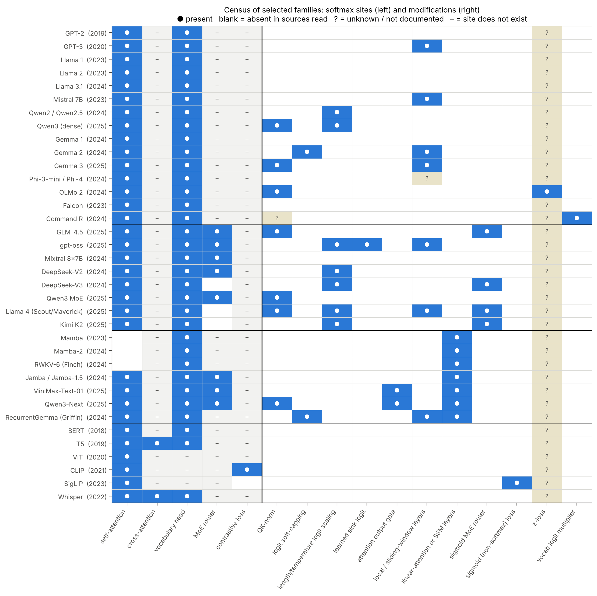
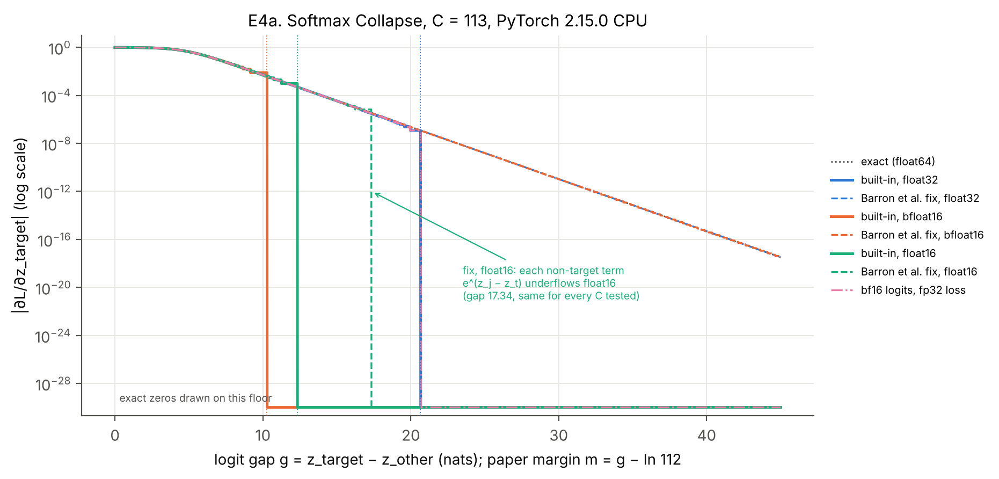

Full technical report, with sources, methods and every number's data file: <a href="https://claude.ai/artifact/MGk1tCA5vUx2cCKo8efGqE">Where Softmax Lives</a>

# Softmax across 36 architectures, and three DeepMind claims checked

*Tata Vishnu Vardhan Rao · November 2026 · code and data: `reports/softmax_survey_v2/`*

I work on paged KV-cache attention, so I kept running into papers about "softmax problems". This is version 2 of my notes. This time I read the full text of every core paper, built a census of 36 model families from their configs and code, and reran the mechanisms on CPU. It is a survey with small measurements, not a new method. Claims are tagged **[proven]**, **[paper]**, **[config]**, **[measured]** or **[inference]**, as in the report.

## Softmax is still everywhere, just less often in the router

Every generative family in the census keeps a softmax in its vocabulary head, including the non-attention ones such as Mamba and RWKV-6 [config]. What has changed is everything around it. Gemma 2 soft-capped its logits; Gemma 3 swapped that for QK-norm [paper]. gpt-oss adds a learned sink logit to every head [paper]. Qwen3-Next puts a sigmoid gate on its attention output [config]. DeepSeek-V3, Kimi K2, GLM-4.5 and Llama 4 route experts with a sigmoid instead of a softmax [config].

## Dispersion: sharp attention fades as context grows

Veličković et al. (Google DeepMind, ICML 2025) prove that with bounded logits, every softmax coefficient in a global head eventually falls toward 1/n [paper]. The toy version is easy to see. Put one key at gap Δ above N − 1 identical keys. To hold weight α on it, you need Δ/T ≥ ln(N−1) + ln(α/(1−α)) [proven]. Each factor-of-e increase in context costs one more logit unit.

So which families ship something that grows with log N? I calibrated a toy head to hold 90% at 4k tokens and applied each family's real logit multiplier.

; the multiplier needed to hold α = 0.9 versus the multipliers families ship, relative to N = 4,096 (right). Toy best case. Takeaway: Llama 4's length-dependent temperature tracks the requirement; constant YaRN factors buy a fixed amount of headroom.")

With no scaling, the head's weight falls to 0.22 at 128k and 0.004 at 10M [measured]. Llama 4 multiplies queries on its global NoPE layers by 1 + 0.1·ln(⌊(pos+1)/8192⌋ + 1), according to Meta's reference code [config]. That keeps the toy head at 0.85–0.87 all the way to 10M [measured]. YaRN's constant factor helps until about the length it was set for. With Qwen3's opt-in factor of 4, the head holds 0.86 at 128k and 0.44 at 1M [measured]. Two caveats. This is one target against identical distractors. And for gpt-oss and DeepSeek, YaRN is in place during long-context training, so the learned gaps already absorb it [inference].

## The paper's adaptive temperature switches off at long context

The paper also proposes an "ad-hoc" fix: sharpen each attention row by an amount set by a degree-4 polynomial in the row's entropy [paper]. I ran that polynomial exactly as printed in their JAX code.

, max weight with and without the paper's adaptive θ (b), and the polynomial itself (c). Takeaway: the polynomial sharpens only rows with entropy between 0.85 and 5.95 nats.")

It only sharpens rows whose entropy is between 0.85 and 5.95 nats [measured]. Within that window it works well: a target planted 4σ above Gaussian distractors goes from 0.125 to 0.80 of the row at N = 235. From N = 861 the row entropy is above the window, β drops to 1, and nothing changes [measured]. A uniform row over 4,096 keys already has 8.3 nats [proven]. This fits the authors' description of the fix as fitted to their own task. It also means the polynomial cannot be dropped into long-context LLM heads unchanged [inference].

## Collapse: where the gradient rounds to exactly zero

Barron, Gnanapragasam and Tschannen (Google DeepMind, 2026) describe two bugs [paper]. **Softmax Collapse** happens when the correct class is so confident that its gradient rounds to 0 while the others' gradients do not. **Softmax Cancellation** happens in distillation: the gradient should be 0 when the student equals the teacher, but rounding leaves noise. The term "Softmax Collapse" comes from earlier work at Imperial College London by Prieto et al. [paper]. I reproduced both in CPU PyTorch, with the paper's own fixed functions translated from JAX.

Some numbers I had wrong in v1, now corrected. All of them are specific to CPU PyTorch [measured]:

* **float32.** With 113 classes, the built-in gradient first hits zero at gap 20.661. That is ln(C−1) + ln(1/ε): paper margin 15.94, not the paper's 16.6. The paper's 16.6 is what I get with two classes.
* **bfloat16 and float16.** Thresholds sit at ln(C−1) + ln(2/ε): paper margins of about 5.55 and 7.62.
* **The realistic setup.** With bf16 logits and an fp32 loss (autocast), the bf16 cliff disappears and the fp32 cliff remains. v1's "20.75" was the first bf16-representable gap above 20.661.
* **The fix in float16.** It still returns zero from gap 17.34 for every class count I tried, because each e^(z_j − z_t) underflows fp16 there.

For cancellation, with 1,000 classes and the student equal to the teacher, the built-in gradient is 1.2×10⁻³ in pure bf16 and 9×10⁻⁹ in fp32, while the fix returns exactly 0 [measured]. In bf16 the larger part of that error comes from storing the student's log-softmax in bf16, not the teacher's probabilities [measured].

**Why a serving engineer should care.** These are training bugs, but log-probabilities have a forward version of the same cliff. With a 151,936-token vocabulary, a bf16 log-softmax returns log p = 0 for any token with p ≳ 0.996 [measured, synthetic logits]. I read the serving code. vLLM computes log-probs in float32 [config]. SGLang does too by default, but its RL on-policy mode deliberately computes them in bf16 to match a bf16 trainer [config]. That is the one path where this failure is expected.

## Where decode attention overtakes the weight matmuls

: exp() work per decode token, decode attention FLOPs relative to weight-matmul FLOPs, and cache size. A model, not a measurement. Takeaway: the crossover ranges from ~4k tokens (MLA) to ~324k (Gemma 3's 5:1 local/global).")

At exactly 32,768 tokens, the model gives [measured, analytic model] these KV caches: Llama-3.1-8B 4.00 GiB, DeepSeek-V3 2.15 GiB, Gemma-3-27B 2.91 GiB, and Qwen3-Next 0.82 GiB including its DeltaNet state. DeepSeek-V3's weight-absorbed MLA decode does so much attention arithmetic per key that it overtakes its weight matmuls at about 4.3k tokens. It can afford that, because decode is memory-bound [inference]. On a B200, FlashAttention-4 gives 8,192 tensor-core FLOPs per clock per SM against 16 exponentials, a ratio of 512. That exactly equals the 4d matmul FLOPs per score at d = 128 [paper] [proven]. That is why FA4 emulates part of exp2 on the FMA units.

## What I could not do, and what is next

The real-model probes (attention entropy, first-token sink mass and needle retrieval on Qwen3-0.6B, Gemma-3-1B, SmolLM2-360M and a matched softmax/softpick pair) are written and smoke-tested. They did not run: this environment's network policy blocked the Hugging Face weight CDN. So every claim here about sinks in real models comes from the papers, not from me. All experiments are CPU toys or analytic models.

On a GPU with SGLang, the next tests are:

* whether gpt-oss's learned sinks make "pin the first KV page" unnecessary under paged eviction;
* whether Llama-4-style log-length scaling, applied to global layers, keeps a real retrieval head's needle weight up at 128k;
* how often bf16 RL-mode log-probs return exactly 0 compared with fp32.

The report says what would count as a positive result for each.
