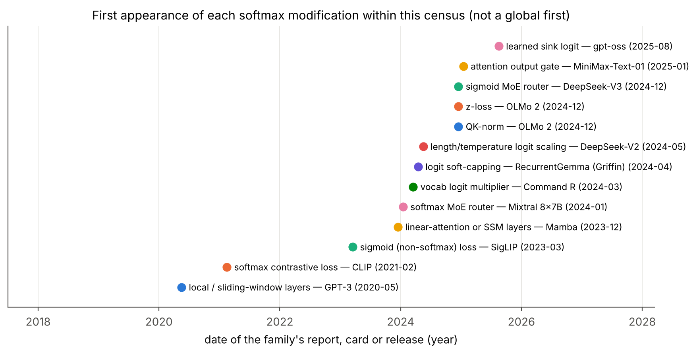
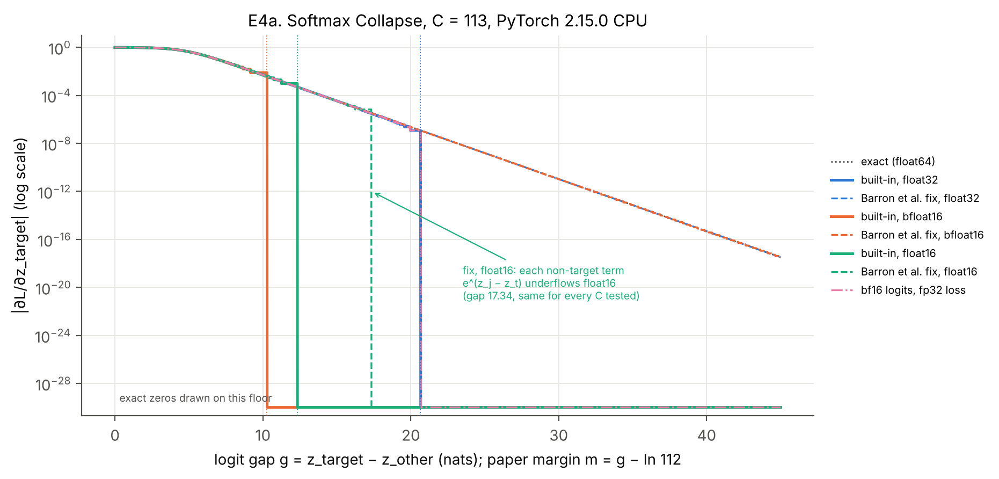

# Where Softmax Lives in Modern Models

**A source-checked survey, a census of 36 model families, and CPU reproductions of three Google DeepMind claims about softmax**

*Tata Vishnu Vardhan Rao · technical report, version 2 · November 2026 · code, data and sources: `reports/softmax_survey_v2/`*

> **Abstract.** Softmax appears in a served model at up to five places: self-attention, cross-attention, the vocabulary head, mixture-of-experts routers and contrastive losses. This report checks four papers in full text, including three with Google DeepMind authors, on dispersion, attention sinks and numerical collapse and cancellation. It then builds a source-backed census of 36 model families, and maps each claim onto each family. Five CPU experiments reproduce the mechanisms. One finding is that the published adaptive-temperature polynomial only sharpens rows whose entropy lies between 0.85 and 5.95 nats. Another is that CPU PyTorch's float32 cross-entropy collapses at paper margin ln(1/ε) ≈ 15.94 nats when there are 113 classes or more, not at the paper's 16.6. A cost model locates the context length at which decode attention overtakes the weight matmuls in four released configs. Real-model probes (E6, E7) were written and smoke-tested. They were not run, because the session could not download model weights.

**Keywords:** softmax, attention, dispersion, attention sinks, Softmax Collapse, numerical precision, mixture of experts, KV cache, LLM serving

---

## 1 Introduction

Discussions of "softmax problems" mix up several different things. A kernel paper about the throughput of `exp` and a training-dynamics paper about rounding in a gradient both say they "fix softmax", yet they have almost nothing in common. Three recent lines of work with Google DeepMind authors make three separate claims. Softmax cannot stay sharp as the number of items grows (*dispersion*) [@velickovic]. The attention sink on the first token is a learned way to limit over-mixing [@barbero]. And standard softmax and cross-entropy code has two floating-point bugs, *Softmax Collapse* and *Softmax Cancellation* [@barron]. The name *Softmax Collapse* comes from earlier work at Imperial College London [@prieto].

This report asks where softmax appears in current model families, how each family has changed or replaced it, and whether each claim applies to each family. It is a **survey with measurements, not a novel-method paper**. Its contributions are:

1. **Source verification.** Each claim is checked against the full text of its paper (§4, References). Version 1 of this report could not reach arXiv and relied partly on secondary summaries. Every such number has now been rechecked against the full text, or removed.
2. **A census** of 36 selected families, built from official configs, reference code, model cards and technical reports (§3). It is a census of the families listed, not an estimate of what fraction of all architectures use softmax.
3. **A family-by-family mapping** of the claims, ending in a matrix with a source behind every cell (§5).
4. **Reproductions** (E1–E5) of the mechanisms on CPU, with code, raw JSON and stdout for every figure (§6). E6 and E7 are written and smoke-tested but not run (§6.6).

I did not search the literature exhaustively, so nothing here is claimed as new. Two results in §6 were not stated in the papers I read: the entropy window of the adaptive-temperature polynomial (E3), and the C-dependence of the float32 collapse threshold on CPU (E4). I checked them only against those papers.

**How claims are tagged.** **[proven]** a mathematical fact derived here or standard. **[paper]** a paper's own claim, taken from its full text. **[config]** read from an official config.json, model card or reference code. **[measured]** produced by this report's code, with the data file named. **[inference]** my reasoning, untested.

**About the study note.** The brief mentions a study note, "Softmax in modern AI — DeepMind findings and study plan". It was not attached to this session, so I used the brief's source list instead.

## 2 Background

### 2.1 Softmax and its gradient

For logits $z \in \mathbb{R}^N$ and temperature $T>0$,

$$\mathrm{softmax}(z/T)_i = \frac{e^{z_i/T}}{\sum_{j=1}^{N} e^{z_j/T}}, \qquad \sum_i \mathrm{softmax}(z/T)_i = 1.$$

Implementations subtract $m=\max_j z_j$ before exponentiating. This prevents overflow but leaves other rounding problems in place (§4.3). Two properties matter throughout. The outputs are positive and sum to one, so a row cannot withhold mass. And an item's weight depends on logit *differences* and on the number of competitors. Cross-entropy with target distribution $p$ and prediction $q=\mathrm{softmax}(z)$ has gradient $q-p$ with respect to $z$ [proven].

### 2.2 Attention softmax

A head with query $q_t$, keys $k_1,\dots,k_n$ and head dimension $d$ computes

$$a_{t,i} = \mathrm{softmax}_i\!\left(\frac{q_t^\top k_i}{\sqrt d}\right),\qquad o_t=\sum_i a_{t,i}\,v_i .$$

There is one softmax row per query, per head, per layer. In prefill all rows are computed together. In decode, each new token adds one row per head, and the row's length is the current context, or the window size for local layers. Fused kernels never write the row to memory. They keep a running maximum and a running sum, and rescale partial outputs when the maximum changes ("online softmax") [@fa1].

### 2.3 Vocabulary softmax and sampling

The output head maps a hidden state $h\in\mathbb{R}^{d_\text{model}}$ to $q=\mathrm{softmax}(Wh/T)$ over $V$ tokens. In training this feeds the cross-entropy loss. In serving it is used for sampling, at temperature $T$, often after top-k or top-p truncation. Log-probabilities returned to clients, for example to reinforcement-learning trainers, are $\log q$.

### 2.4 Router and contrastive softmax

A mixture-of-experts (MoE) router computes scores $r=W_r h$ over $E$ experts. Some designs take a softmax over all $E$ and keep the top $k$ (Qwen3-MoE, Jamba, MiniMax). Some take the top $k$ first and then a softmax over only those (Mixtral, gpt-oss). Others replace the softmax with a sigmoid (DeepSeek-V3, Kimi K2, GLM-4.5, Llama 4) [config]. In CLIP-style training, a softmax over the batch's image-text similarity matrix defines a contrastive loss. SigLIP replaces it with a pairwise sigmoid loss [@siglip].

## 3 Architecture census

### 3.1 Method

For each family I read its official `config.json` on the Hugging Face Hub [@hfconfigs], the reference modelling code (Hugging Face transformers at commit `3568df44` [@hftransformers], or the vendor's own code where noted [@llamamodels]), the model card [@cards], and the technical report where one exists [@gpt3; @llama1; @llama2; @llama3; @mistral; @mixtral; @qwen2; @qwen3; @gemma1; @gemma2; @gemma3; @phi3; @olmo2; @falcon; @glm45; @gptoss; @dsv2; @dsv3; @kimik2; @mamba; @mamba2; @jamba; @jamba15; @rwkv6; @minimax; @recurrentgemma; @bert; @t5; @vit; @clip; @siglip; @whisper]. Four configs were gated for my token (403): Llama 2, Llama 4, Command R and Jamba 1.5. For those, the census uses the paper, the model card and the code defaults, and says so in the row. A feature counts as present only if a source shows it. Where the sources are silent the cell is *unknown*, not *absent*. z-loss is a training-recipe detail that most reports do not mention, so it is unknown for every family except OLMo 2.

Every autoregressive decoder also has a sampling softmax at serving time. It is the same softmax as the vocabulary head, so it is not a separate column.

### 3.2 Results

 and softmax modifications (right) for 36 selected families, grouped as dense decoders, MoE, hybrid or non-softmax, and encoder/multimodal. ● present; blank, absent in the sources read; ?, unknown or not documented; –, the site does not exist. Sources per row are in data/census.json. Takeaway: almost every family keeps softmax in at least two places (vocabulary head, and attention or router); the modifications cluster after 2024.")

**Table 1.** Abbreviated census. Full rows with all sources: `data/census_table.md` and `data/census.json` [config/paper].

| Family | Attention | Context | Vocab | Router | Softmax modifications |
|---|---|---|---|---|---|
| Llama 3.1 | GQA, 8 KV heads | 131,072 | 128,256 | – | none found (RoPE frequency rescaling only) |
| Mistral 7B | GQA + sliding window 4,096 | 32,768 | 32,000 | – | sliding window |
| Qwen3 (dense) | GQA, QK-norm | 40,960 (131,072 with YaRN ×4) | 151,936 | – | QK-norm; opt-in static YaRN |
| Gemma 2 | GQA, local 4,096 / global alternating | 8,192 | 256,000 | – | soft-cap 50 (attention), 30 (logits) |
| Gemma 3 | 5 local (1,024) : 1 global, QK-norm | 131,072 (1B: 32,768) | 262,144 | – | QK-norm replaces soft-capping |
| OLMo 2 | MHA, QK-norm | 4,096 | 100,352 | – | QK-norm, z-loss |
| gpt-oss | GQA 64/8, alternating window 128 / dense | 131,072 | 201,088 | softmax over selected top-4 | learned sink logit per head; YaRN ×32 |
| Mixtral 8×7B | GQA | 32,768 | 32,000 | softmax over top-2 of 8 | – |
| DeepSeek-V2 | MLA | 163,840 | 102,400 | softmax, top-6 of 160 | YaRN, softmax scale ×1.590 |
| DeepSeek-V3 | MLA | 163,840 | 129,280 | sigmoid + bias, top-8 of 256 | YaRN, softmax scale ×1.874 |
| Qwen3-MoE | GQA, QK-norm | 40,960 | 151,936 | softmax, top-8 of 128 | QK-norm |
| Llama 4 | chunked local 8,192 + NoPE global every 4th | 10M (Scout) | 202,048* | sigmoid, top-1 + shared | temperature tuning on NoPE layers; QK-norm* |
| Kimi K2 | MLA | 131,072 | 163,840 | sigmoid + bias, top-8 of 384 | YaRN ×32 |
| GLM-4.5 | GQA 96/8, QK-norm | 131,072 | 151,552 | sigmoid, top-8 of 160 | QK-norm |
| Jamba 1.5 | 1 attention : 7 Mamba | 262,144 | 65,536* | softmax, top-2 of 16 | Mamba layers, no positional encoding |
| MiniMax-Text-01 | 7 lightning (linear) : 1 softmax | 1M train / 4M inference | 200,064 | softmax, top-2 of 32 | linear-attention layers, output gate |
| Qwen3-Next | 3 Gated DeltaNet : 1 gated attention | 262,144 | 151,936 | softmax, top-10 of 512 | sigmoid output gate, QK-norm |
| RecurrentGemma | 2 RG-LRU : 1 local MQA (2,048) | – | 256,000 | – | final soft-cap 30 |
| Mamba / Mamba-2 / RWKV-6 | none | – | 50,280 / 50,277 / 65,536 | – | no attention softmax |
| CLIP / SigLIP | ViT + text encoder | 77 / – | 49,408 / 32,000 | – | softmax contrastive loss / sigmoid loss |

\* From the Hugging Face config class defaults or the reference code, because the released config is gated. The released values were not checked.

Four observations stand out [config/paper]:

* **The vocabulary softmax is universal among the generative families**, including the non-softmax backbones (Mamba, Mamba-2, RWKV-6). None of the 36 families removes it.
* **MoE routing is moving from softmax to sigmoid.** DeepSeek-V3, Kimi K2, GLM-4.5 and Llama 4 score experts with a sigmoid. Mixtral, DeepSeek-V2, Qwen3-MoE, Jamba, MiniMax-01, Qwen3-Next and gpt-oss use a softmax, either before or after top-k.
* **Logit-range control changed between generations of one family.** Gemma 2 soft-capped attention and output logits; Gemma 3 replaced attention soft-capping with QK-norm [@gemma3]. QK-norm also appears in OLMo 2, Qwen3, GLM-4.5, Qwen3-Next and, by code default, Llama 4.
* **Explicit sink or gating mechanisms are recent.** In this census they appear only in gpt-oss (a learned sink logit per head, Aug 2025) [@gptoss], Qwen3-Next (a sigmoid output gate on softmax attention, Sep 2025) and MiniMax-01 (a gate on its *linear*-attention layers).



The timeline counts only census rows. QK-norm, for example, was proposed in 2020 [@qknorm] and used in ViT-22B in 2023 [@vit22b], and neither is a census row.

## 4 The four issue types and the DeepMind claims

The papers address four different issue types. Confusing them leads to wrong expectations, such as expecting a numerically fixed softmax to help long-context retrieval.

1. **Selection and dispersion.** What softmax *can represent* as the number of items grows.
2. **Attention sinks.** Where the mass goes when a head has nothing to read, given that the weights must sum to one.
3. **Numerical collapse and cancellation.** What goes wrong when the gradient, or a log-probability, is computed in finite precision.
4. **Output expressivity.** What the vocabulary head can represent, given that the rank of $\log q$ across contexts is limited by $d_\text{model}$ [@bottleneck].

Runtime cost (exp throughput, KV traffic) is a fifth concern. It is treated in E5 and §7.

### 4.1 Dispersion — Veličković, Perivolaropoulos, Barbero, Pascanu [@velickovic]

*Claim* [paper]. If the logits in a row are bounded, every softmax coefficient is $\Theta(1/n)$ as the number of items $n$ grows (Lemma 2.1). In a Transformer of MLPs and softmax self-attention over a finite token vocabulary, the logits are bounded. So for any temperature $\theta>0$ and any $\epsilon>0$, there is an $n$ at which every coefficient of every *global* head is below $\epsilon$ (Theorem 2.2). Their bound is $\alpha_k \le \tfrac1n e^{\delta/\theta}$, where $\delta$ is the logit spread.

*Assumptions.* A finite input vocabulary, continuous layers, a non-zero temperature, and global attention. The paper names three ways out: unnormalised attention (linear, sigmoid, stick-breaking), hard or local attention, and removing excess attention as selective attention does [@selective].

*Scope.* A single-head max-retrieval model trained on sets of at most 16 items and tested on up to 16,384 items. Gemma 2B fine-tuned on the 30 CLRS-Text algorithmic tasks. Entropy measurements on Gemma 2B heads.

*Finding with number* [paper]. With adaptive temperature applied only at inference, max-retrieval accuracy over ten seeds rose from 81.3% to 82.1% at 256 items and from 12.4% to 14.0% at 16,384 items (Table 1). On a ~4,000-token code sample, Gemma 2B's measured logit spread δ ranged over [2.28, 14.78], with mean 5.69 ± 2.05.

*Limitation.* The authors call adaptive temperature "ad-hoc" and say it "does not escape the conclusions of our theory". Its polynomial was fitted on one synthetic task. For CLRS-Text it had to be applied during fine-tuning as well as at inference, and they suggest the remaining failures may come from contexts longer than those the fit was derived on. The full JAX code is in their Figure 4. E3 below uses it exactly as printed.

### 4.2 Attention sinks — Barbero, Arroyo, Gu, Perivolaropoulos, Bronstein, Veličković, Pascanu [@barbero]

*Claim* [paper]. Heavy attention to the first token is a learned mechanism that lets deep Transformers avoid *over-mixing*, the collapse of token representations under repeated attention. Their Theorem 3.2 bounds token-to-token sensitivity by sums over attention paths. A sink that absorbs attention while its value vector has small norm acts as an approximate no-op, which caps that sensitivity.

*Assumptions.* Decoder-only Transformers with causal softmax attention. The bound does not differentiate through the softmax.

*Scope.* Perturbation and attention-map analyses of Gemma 7B. The Llama 3.1 family (8B, 70B, 405B). 120M-parameter LLaMA-2-style models pre-trained from scratch, following Gu et al. [@gu], with varied context length and data packing.

*Finding with number* [paper]. With threshold ε = 0.8, the share of heads with a strong first-token sink is 45.97% for Llama 3.1 8B, 73.49% for 70B and 78.29% for 405B (Table 1). Separately, removing ⟨bos⟩ from Gemma 7B at inference drops RULER at 4,096 tokens from 82.57 to 0.00 (Table 3).

*Limitation.* The paper explains why sinks are useful. It does not test sink-free alternatives at scale, and it offers no serving method. In its own pre-training runs, models trained with ⟨bos⟩ fixed at position 0 lose their sink and their loss (2.69 → 7.56) when ⟨bos⟩ is removed at inference (Table 2). That makes sink handling a deployment concern [inference].

### 4.3 Collapse and cancellation — Barron, Gnanapragasam, Tschannen [@barron]

*Claim* [paper]. Standard softmax, log-softmax and cross-entropy have two numerical bugs.
**Softmax Collapse.** When the target logit leads by margin $m=z_t-\mathrm{LSE}_{j\ne t}z_j$, the denominator $1+e^{-m}$ rounds to 1 beyond a "precision cliff" $c_d$. They give ≈5.5 in bf16, 16.6 in fp32 and 36.7 in fp64. Above the cliff the target gradient $q_t-1$ is exactly 0, while the non-target gradients stay positive, so the gradients no longer sum to zero.
**Softmax Cancellation.** In distillation, computing $q$ and $p$ separately and subtracting them loses precision. Small differences between the forward softmax and the backward log-softmax leave a non-zero gradient even when the student and teacher logits are equal.
The fix computes everything relative to the target or the arg-max in log space, using `softplus`, `log1p` and `expm1`, without casting to higher precision. JAX code for both fixes is printed in the paper.

*Assumptions.* Max-subtracted implementations. Collapse needs high-confidence targets. Cancellation needs a student close to its teacher.

*Scope.* Grokking benchmarks: a 1-layer Transformer and 2-layer MLPs on modular arithmetic, with AdamW or LaProp, across bf16, fp32 and fp64. Distillation of a 2-layer MLP student initialised at the teacher's weights.

*Finding with number* [paper]. On a + b mod 31 at ε = 10⁻⁸, fixed fp32 cross-entropy reaches 100.0 ± 0.0% test accuracy against 94.3 ± 5.4% for standard fp32 cross-entropy (Table 1). Without weight decay on a² + b² mod 97, a slingshot spike at the fp32 cliff drops standard test accuracy from 61% to 23%, while the fixed version continues to 85%. They also derive that the margin settles at $m^\star\approx\log(1/\epsilon_\text{Adam})$.

*Limitation.* The authors note that "the extreme margins and near-zero student–teacher gaps probed by our experiments are uncommon in standard large-scale training". Every experiment is small-scale. The arXiv listing is at v3 (29 Oct 2026). An erratum says an earlier version of the printed code gave NaN gradients when all but one logit is −∞.

### 4.4 Origin of "Softmax Collapse" — Prieto, Barsbey, Mediano, Birdal [@prieto]

*Claim* [paper]. Without regularisation, grokking tasks push models into floating-point *absorption errors* in softmax, which they name Softmax Collapse. Once the correct-class term absorbs the rest of the sum, the loss and the correct-class gradient become exactly zero. The logits grow because the gradient aligns with *naïve loss minimisation*, a direction that only scales the logits. Their fixes are StableMax, a softmax with a ramp-shaped function in place of exp, and ⊥Grad, which removes the gradient component along the weights.

*Scope.* MLPs and a 1-layer Transformer on modular arithmetic mod 113, sparse parity, and a 200-sample MNIST subset.

*Finding with number* [paper]. With ⊥SGD, the model "reaches 100% test accuracy within 400 iterations" on modular addition (Fig. 6a). Without regularisation, standard softmax cross-entropy stays at chance in the 40%-training-data setting (Fig. 2a, Fig. 4).

*Limitation.* Prieto et al. are at Imperial College London; this is not a DeepMind paper. The tasks are tiny. Barron et al. report that StableMax inflates margins to ~10³–10⁴ and trails their fix (their Table 1).

### 4.5 Other Google and Google DeepMind work bearing on the claims (2023–2026)

All of the following were read in full text [paper]:

* **Selective attention** (Leviathan, Kalman, Matias, Google Research) [@selective]. A parameter-free change that reduces attention to unneeded elements. They report language modelling equivalent to standard Transformers with about twice as many attention heads and parameters. It bears on dispersion, which Veličković et al. explicitly connect it to.
* **Round and round we go** (Barbero et al.) [@roundround]. Gemma 7B uses RoPE's highest frequencies to build positional attention patterns. This bears on why RoPE rescaling, unlike logit scaling, does not address dispersion directly.
* **Transformers need glasses!** (Barbero et al.) [@glasses]. Proves a *representational collapse* in which distinct inputs map to arbitrarily close final-token representations, an effect "exacerbated by the low-precision" formats. This is the over-squashing theory that the sink paper builds on.
* **Gemma 2 and Gemma 3 reports** [@gemma2; @gemma3]: logit soft-capping, then QK-norm, plus local/global layer ratios.
* **Griffin and RecurrentGemma** [@griffin; @recurrentgemma]: linear recurrences mixed with local attention.
* **Infini-attention** (Munkhdalai, Faruqui, Gopal) [@infini]: a compressive linear-attention memory alongside softmax attention, for unbounded context.
* **SigLIP** (Google DeepMind Zürich) [@siglip]: removes softmax from the contrastive loss.

## 5 The claims across architectures

### 5.1 Dispersion

Dispersion applies to **global softmax heads whose key count grows with context**. A local or sliding-window head sees at most its window, so its row length is bounded no matter how long the context gets [proven]. Mitigations, classified by whether they act on dispersion directly:

* **Directly: length-dependent logit scaling.** Llama 4 multiplies the query by $1+0.1\ln(\lfloor(\text{pos}+1)/8192\rfloor+1)$ on its NoPE global layers [config: llama-models `model.py`]. Scalable-Softmax uses $s\ln n$ [@ssmax]. Sigmoid attention uses a bias $b=-\log n$ [@sigmoidattn]. Each grows with $\log n$, which is the rate E2 shows is needed.
* **Partly: constant YaRN temperature.** YaRN multiplies the logits by $(0.1\ln s+1)^2$, where $s$ is the extension factor [@yarn]. Shipped values are ×1.813 for gpt-oss and Kimi K2 (s = 32), ×1.874 for DeepSeek-V3 (s = 40, applied through the softmax scale in the DeepSeek code path), ×1.590 for DeepSeek-V2, and ×1.296 for Qwen3's opt-in s = 4 [config]. The factor is the same at every length, so it buys a fixed amount of headroom (E2). Where YaRN is applied during long-context training (gpt-oss, DeepSeek), the learned logits already absorb the factor [inference].
* **Indirectly: local/global mixing.** Gemma 2/3, Mistral, gpt-oss, Llama 4 chunked layers, RecurrentGemma. This caps row length in most layers but leaves the global layers exposed [proven]. It is mainly a KV-memory measure (E5).
* **Not at all: RoPE frequency rescaling alone.** Llama 3.1's `llama3` rope, Gemma 3's linear ×8 on global layers. These change positions, not the logit scale [config]. **QK-norm** bounds $\|q\|$ and $\|k\|$, which by Proposition 3.1 of [@velickovic] *bounds* the spread. It helps stability, but if anything it tightens the dispersion bound [inference].
* **Different mechanism: linear attention and SSM layers.** Mamba, RWKV-6, the DeltaNet layers of Qwen3-Next, MiniMax's lightning layers. These are not softmax-normalised, so Theorem 2.2 does not apply to them [paper]. They have their own capacity limits, which are not studied here. The softmax layers in these hybrids remain exposed.
* **MoE routers:** essentially not applicable. $E$ is fixed (8–512) and does not grow with context. The score vector has 8–512 entries no matter how long the input is [proven].

### 5.2 Attention sinks

Sinks have been *measured* in LLaMA-2/3 and Mistral models [@gu] and in Llama 3.1 8B–405B [@barbero]. StreamingLLM shows that window-only attention fails without the initial tokens for Llama-2, MPT, Falcon and Pythia [@streamingllm]. Gu et al. find that a sink "acts more like key biases" and that sigmoid attention without normalisation shows no sinks up to 1B parameters [@gu]. Three kinds of response appear:

* **Ship an explicit sink.** gpt-oss gives each head "a learned bias in the denominator of the softmax", which lets a head attend to nothing [@gptoss] [config: `sinks` parameter]. FlashAttention-4 supports this as `learnable_sink`: one extra softmax column per head, with no value vector [@flashattn] [config]. StreamingLLM proposed a dedicated sink token during pre-training [@streamingllm].
* **Claim to remove sinks.** Gated attention, a sigmoid gate on the attention output, cuts the average share of first-token attention across layers from 46.7% to 4.8% in its baseline comparison [@gatedattn]; Qwen3-Next ships such a gate [config]. Softpick, a rectified softmax that need not sum to one, reports a sink rate of 0.00% against 63.41% for matched 340M softmax models [@softpick]. Sigmoid attention removes the sum-to-one constraint [@sigmoidattn].
* **Do nothing explicit.** Every other softmax family in the census. Whether a family shows sinks has to be *measured*. E6 was designed to do that and could not run.

**For KV eviction** [inference, building on established results]. StreamingLLM shows that a window-only cache breaks generation unless "4 initial tokens" are kept [@streamingllm] (established). KVSink argues that sinks are not always at the first positions and predicts them for KV-cache quantization [@kvsink] (established, for quantization). For a learned-sink model such as gpt-oss, the sink is a parameter, not a cached token, so pinning the first page should be unnecessary. That is a hypothesis for §9, not a result.

### 5.3 Collapse and cancellation

These are **training-time** bugs in the gradient. At **inference**, only the forward analogue matters: $\log q_t$ rounding to exactly 0 for confident tokens (E4c). Exposure therefore depends on the training recipe and on the serving log-prob path, not on the architecture:

* Float32 loss (autocast) moves the cliff from the bf16 value to the fp32 value. It does not remove it (E4a: the bf16-logit, fp32-loss setup collapses at gap 20.69 on the grid, or 20.75 after rounding to bf16).
* z-loss (PaLM, OLMo 2) pushes $\log Z$ toward 0 [@palm; @olmo2]. It does not bound the margin, so by itself it does not prevent collapse [inference].
* Final-logit soft-capping (Gemma 2 at 30, RecurrentGemma at 30) bounds every logit to ±30, so the gap is at most 60 [config]. Under fp32 that still allows gaps beyond the 20.7–27.9 thresholds measured in E4 [inference from E4].
* Fused cross-entropy kernels: not inspected for this report. Unknown.
* **Distillation pipelines** are exposed to cancellation whenever the student is close to its teacher and the loss is computed in low precision. E4b shows a floor of ~1.2×10⁻³ in pure bf16 and ~10⁻⁸ in fp32 [measured]. No census family documents its distillation loss implementation, so it is unknown for all of them.

### 5.4 Output expressivity

The log-probability matrix of a softmax head has rank at most $d_\text{model}+1$ across contexts, the *softmax bottleneck* of Yang et al. [@bottleneck] [paper]. In the census, $V/d_\text{model}$ ranges from 7.8 (Mistral 7B and Mixtral: 32,000/4,096) through 18.0 (DeepSeek-V3: 129,280/7,168), 31.3 (Llama 3.1-8B: 128,256/4,096), 65.4 (GPT-2: 50,257/768) and 69.8 (gpt-oss: 201,088/2,880) to 227.6 (Gemma 3-1B: 262,144/1,152) [config]. So $V$ exceeds the rank bound $d_\text{model}+1$ by roughly 8× to 228×. **No census family ships a bottleneck-breaking head** such as a mixture of softmaxes. The trend is towards larger vocabularies at fixed width, which widens $V/d$ [config]. Whether this costs quality at current widths is not tested here.

### 5.5 Matrix

**Table 2.** Exposure by family. E = exposed; M = mitigated (how); N/A = not applicable; ? = unknown. Sources are the census rows (§3) and the papers named.

| Family | Dispersion | Sinks | Collapse / cancellation (training) | Output expressivity |
|---|---|---|---|---|
| GPT-2/3, Llama 1–3.1, Falcon, Phi | E (global heads; GPT-3 half local) | E (measured in Llama 2/3/3.1 [@gu; @barbero]; window failure in Falcon [@streamingllm]); others ? | ? (recipes not documented) | E (no MoS) |
| Mistral 7B | M-indirect (window 4,096) | E (measured [@streamingllm; @gu]) | ? | E |
| Qwen2/2.5/3, Qwen3-MoE | M-partial (opt-in static YaRN) | ? | ? | E |
| Gemma 2 | M-indirect (local/global) | ? | M-partial (soft-cap 30) | E |
| Gemma 3 | M-indirect (5:1 local) | ? | ? (soft-cap removed) | E (V/d = 228 at 1B) |
| OLMo 2 | E | ? | M-partial (z-loss) | E |
| gpt-oss | M-partial (YaRN ×1.813, window 128 layers) | M (learned sink logit) | ? | E |
| DeepSeek-V2/V3, Kimi K2 | M-partial (YaRN ×1.59 / ×1.87 / ×1.81) | ? | ? | E |
| Llama 4 | M-direct (log-length temperature, NoPE layers) | ? | ? | E |
| GLM-4.5, Command R | E | ? | ? | E |
| Qwen3-Next | E in 1 of 4 layers; N/A in DeltaNet layers | M (sigmoid output gate [@gatedattn]) | ? | E |
| MiniMax-01, Jamba | E in 1 of 8 layers; N/A elsewhere | ? | ? | E |
| RecurrentGemma | M-indirect (local window 2,048 only) | ? | M-partial (soft-cap 30) | E |
| Mamba, Mamba-2, RWKV-6 | N/A (no attention softmax) | N/A | ? | E |
| BERT, T5, Whisper | E within fixed max length (512 / 448) | E (BERT "no-op" attention, Clark et al. 2019 as cited in [@barbero]) | ? | E (MLM / decoder heads) |
| ViT, CLIP, SigLIP | E only if the patch count grows | ? | CLIP: ?; SigLIP: N/A (sigmoid loss) | N/A |

## 6 Experiments

All experiments ran on CPU: Python 3.13.18, NumPy 2.5.4, Matplotlib 3.11.2, PyTorch 2.15.0 (the PyPI build, running on CPU), mpmath 1.3.0. Seeds are fixed. Each script writes its figure to `figures/`, raw numbers to `data/*.json` and console output to `data/*_stdout.txt`. Nothing here ran on a GPU.

### 6.1 E1 — Dispersion closed form (illustration, not a finding)

One target logit Δ, $N-1$ distractors at 0, $T=1$. The target weight is $w(N)=e^\Delta/(e^\Delta+N-1)$, and $w=\tfrac12$ at $N=e^\Delta+1$ [proven]. I compared it with float64 softmax over the explicit vector, for $N$ from 2 to 65,536.

 for Δ ∈ {2, 4, 8, 16}, T = 1. Lines: closed form; circles: float64 softmax (every fourth of 60 N values). Takeaway: a fixed gap loses half the target's mass once N passes e^Δ + 1.")

**Result** [measured, `e1_dispersion.json`]. Maximum relative error 1.6×10⁻¹⁵. The half-weight points are N = 8.4, 55.6, 2,982 and 8.9 million. For Δ = 8 the weight is 0.593 at N = 2,048, 0.421 at 4,096, 0.267 at 8,192 and 0.083 at 32,768. So a head with an 8-nat gap still gives the target 42% of its mass at 4k. It falls below 10% only past 32k.

### 6.2 E2 — Gap needed, and what shipped multipliers provide

Requiring $w\ge\alpha$ gives $\Delta/T \ge \ln(N-1)+\ln\frac{\alpha}{1-\alpha}$ [proven]. Bisection on the explicit softmax matches this to within 1.7×10⁻¹³. I calibrated a head to hold α = 0.9 at N = 4,096 (Δ₀ = 10.52), then applied each family's logit multiplier from Part B.

 Required Δ/T for α ∈ {0.5, 0.9, 0.99} versus N; lines are the closed form, circles bisection. (b) Multiplier needed to hold α = 0.9 relative to N = 4,096 (black), against the multipliers families ship. YaRN factors are constant; the gpt-oss/DeepSeek/Kimi factors are in place during their long-context training, so their learned gaps already absorb them. Toy best case: one target, identical distractors. Takeaway: only length-dependent scaling (Llama 4, log-length) tracks the requirement; constant factors buy a fixed amount of headroom.")

**Result** [measured, `e2_temperature.json`]. The required multiplier is 1.198 at 32,768, 1.330 at 131,072, 1.527 at 1,048,576 and 1.746 at 10,485,760. Without scaling, the calibrated head's weight falls to 0.529, 0.219, 0.034 and 0.004 at those lengths. With Llama 4's temperature tuning the multiplier is 1.161, 1.283, 1.486 and 1.716, and the weight stays at 0.85–0.87. That covers 81–96% of the needed increase. Static YaRN with s = 4 (×1.296) holds 0.864 at 131,072, the length it is meant for, but only 0.443 at 1M. In this toy model, the constant ×1.81–1.87 factors exceed the requirement up to about 10M.

**Interpretation.** Llama 4's formula tracks $\ln N$, which is the dispersion rate, and it is applied exactly on the global NoPE layers where dispersion applies. This is the clearest case in the census of a shipped dispersion mitigation [inference]. Real heads have many competitors with spread-out logits, so these are best-case numbers.

### 6.3 E3 — Gaussian logits and the paper's adaptive temperature

Rows of i.i.d. $z\sim\mathcal N(0,\sigma^2)$, σ ∈ {1, 2, 4}, N from 2 to 65,536 (20–400 rows per point, seed 0). For large N the entropy approaches $\ln N-\sigma^2/2$ [proven]. I then applied the adaptive temperature *exactly as printed* in Veličković et al.'s Figure 4:

$$\beta=\max\big(\mathrm{polyval}([-0.037, 0.481, -2.3, 4.917, -1.791], H),\,1\big)\ \text{if } H>0.5,\ \text{else } 1.$$

 I tested it on the Gaussian rows and on rows with one planted target at 4σ or 6σ above Gaussian distractors.

 Mean row entropy (nats) versus N for Gaussian logits, with the ln N − σ²/2 asymptote. (b) Mean max weight at T = 1 (solid) and after the paper's adaptive θ (dashed). (c) The paper's β(H), clipped at 1. 20–400 rows per point. Takeaway: the published polynomial only sharpens rows with entropy between 0.85 and 5.95 nats, so it switches off in exactly the long-context regime where dispersion is worst.")

**Result** [measured, `e3_random_logits.json`].
* The entropy at N = 65,536 is 10.590 against an asymptote of 10.590 for σ = 1, and 9.103 against 9.090 for σ = 2. For σ = 4 it is 4.646 against 3.090, which has not converged, because the log-normal sum needs $N\gg e^{\sigma^2}$.
* **The polynomial gives β > 1 only for H ∈ [0.849, 5.945] nats**, peaking at β = 2.42 at H = 4.41. For σ = 1 and σ = 2 at 65,536 the row entropy exceeds 5.95, so β = 1 and the max weight is unchanged (0.0008 and 0.0136).
* With a target planted 4σ above the distractors, adaptive θ raises its weight from 0.125 to 0.798 at N = 235. It switches off entirely (β = 1) from N = 861. At 6σ it switches off from N = 1,328.

**Interpretation.** This matches the paper's own description: a fit derived on its max-retrieval task, which is "ad-hoc". It does not contradict their Table 1, whose largest test set is 16,384 items for a single trained head whose entropies I did not measure. For scale, a uniform row over 4,096 keys already has ln 4096 ≈ 8.3 nats [proven]. It does mean that this polynomial cannot be used as-is on long-context LLM heads with entropy above ~6 nats [inference]. Refitting it would be needed, as the authors themselves suggest for Gemma.

### 6.4 E4 — Collapse and cancellation in float32, bfloat16 and float16 (CPU PyTorch)

**All thresholds in this section are properties of CPU PyTorch 2.15.0 in this environment.** GPU kernels and other versions may differ.

**E4a setup.** C classes, target logit equal to the gap $g$, all others 0. The paper's margin is $m=g-\ln(C-1)$. I scanned g from 0 to 45 at step 0.01, then at step 0.001 within ±0.25 of each transition. Four setups: **pure** (logits, loss and gradient in the dtype); **upcast** (logits stored in the dtype, `.float()` before `F.cross_entropy`); **autocast** (`torch.autocast('cpu', bfloat16)`, which runs the loss in fp32; the loss dtype was checked); **fixed** (Barron et al.'s Section 2 `cross_entropy`, translated line by line from JAX to torch, autodiff in the dtype).



**Table 3.** First gap at which the built-in target gradient is exactly 0, with the paper's margin in parentheses [measured, `e4_collapse.json`].

| C | float32 pure | bfloat16 pure | float16 pure | bf16 logits, fp32 loss | Barron fix, fp16 |
|---|---|---|---|---|---|
| 2 | 16.636 (16.636) | 5.547 (5.547) | 7.624 (7.624) | 16.688 | 17.336 |
| 113 | 20.661 (15.943) | 10.282 (5.564) | 12.340 (7.622) | 20.688 | 17.336 |
| 1,000 | 22.851 (15.944) | 12.469 (5.562) | 14.528 (7.621) | 22.813 | 17.336 |
| 32,000 | 26.316 (15.943) | 15.907 (5.534) | 17.961 (7.588) | not run | 17.336 |

**Result.**

* **float32.** For C ≥ 113 the threshold is $\ln(C-1)+\ln(1/\epsilon)$ to within 0.002 (paper margin 15.94). For C = 2 it is $\ln(2/\epsilon)$ = 16.636, which is the paper's "16.6". So the paper's fp32 cliff matches CPU PyTorch only for two classes. With more classes, CPU PyTorch collapses about 0.69 nats *earlier* in paper-margin terms. I did not trace this to a specific line of the reduction kernel.
* **bfloat16 and float16.** The thresholds sit at $\ln(C-1)+\ln(2/\epsilon)$ to within 0.04, giving paper margins of 5.53–5.56 (bf16) and 7.59–7.62 (fp16). These agree with the paper's bf16 ≈ 5.5.
* **Realistic setups.** With bf16 logits and an fp32 loss, through either autocast or `.float()`, the bf16 threshold *disappears* and the fp32 one *survives*. It appears at grid gap 20.688 because the gap is first rounded to bf16, whose spacing near 20 is 0.125; 20.6875 rounds to 20.75, the first bf16 value above 20.661. This explains v1's "20.75". It was a bf16 representation artefact, not the fp32 threshold.
* **The fix.** In fp32 and bf16 the fix never returns a zero target gradient on [0, 45]. Its maximum relative error in the normal range is 3.2×10⁻⁷ (fp32) and 9.7×10⁻³ (bf16). In fp16 it returns exactly 0 from gap 17.336 *for every C tested*. The mechanism is that each non-target term $e^{z_j-z_t}=e^{-g}$ underflows fp16 there: `exp(-g)` in fp16 first returns 0 at g = 17.336. The underflow of σ(r) in v1's alternative formulation would instead occur at g = 22.055 for C = 113 and would depend on C. It does not match the data.

**E4b setup (cancellation).** C = 1,000. Teacher logits $z_T\sim\mathcal N(0,3^2)$, rounded to the dtype. Student $z_S=\mathrm{round}(z_T+\varepsilon\xi)$, so ε = 0 means the two are identical. Setups: **all-dtype** (teacher probabilities, loss and gradient in the dtype); **teacher-fp32** (teacher probabilities in fp32, student logits upcast to fp32 for the loss); **autocast** (bf16); **fixed** (Barron et al.'s Section 3 listing, translated, in the dtype). The reference is float64 naive $q-p$ on the same rounded logits; it is not the fix formula. I checked it against mpmath at 50 digits: the maximum absolute difference was ≤ 2.6×10⁻¹⁷ for ε ∈ {0, 10⁻⁶, 10⁻³} in all dtypes.

. Values of 1e-30 mean exactly 0. Dotted: ‖g_ref‖ for fp32 logits. Takeaway: the built-in gradient has an ε-independent floor (≈1e-3 in pure bf16, ≈1e-8 in fp32) that exceeds the true gradient for small ε; the fix returns exactly 0 at ε = 0 in every dtype.")

**Result** [measured, `e4_cancellation.json`]. At ε = 0, the built-in gradient norm is 9.1×10⁻⁹ (fp32), 1.22×10⁻³ (pure bf16) and 2.27×10⁻⁴ (pure fp16). The fix returns exactly 0 in all three. In the teacher-fp32 and autocast setups the bf16 floor falls to 2.2×10⁻⁸. For fp16 the teacher-fp32 floor happens to be exactly 0 for this draw of logits.

**Where the floor comes from.** At ε = 0 the built-in formula is effectively $\exp(\text{log\_softmax}_\text{dtype}(z))-q_\text{dtype}$. I computed each stored term's error in float64:
* **bf16:** student log-softmax stored in bf16 → 1.08×10⁻³; teacher probabilities stored in bf16 → 3.29×10⁻⁴; both → 1.29×10⁻³.
* **fp16:** 2.10×10⁻⁴ and 4.12×10⁻⁵ respectively.
* **fp32:** the floor comes from PyTorch's own two paths. ‖softmax − exp(log_softmax)‖ = 5.3×10⁻⁹, against a floor of 9.1×10⁻⁹.

So low-precision *storage* causes the floor in bf16 and fp16, and PyTorch's gradient path causes it in fp32. In this data the larger term is the student's log-softmax, not the teacher's probabilities. A v1 reviewer suggested the teacher-probability term dominates; this measurement does not support that.

**E4c — forward log-probabilities.** The first gap at which $\log q_t$ is exactly 0 [measured, `e4_forward_logprob.json`]. For C = 151,936 (the Qwen vocabulary), it is gap 27.88 for fp32 `log_softmax`, 27.88 for fp32 `log(softmax)`, 17.44 for bf16 and 19.53 for fp16. In paper margins that is 15.95, 15.95, 5.51 and 7.6. So **a bf16 log-softmax returns log p = 0 for any token with p ≳ 1 − e⁻⁵·⁵ ≈ 0.996**, whereas fp32 does so only when p is within ~10⁻⁷ of 1 [inference from the margin].

### 6.5 E5 — Prefill and decode cost model (a model, not a measurement)

For four released configs I counted, per decode token at batch 1, the softmax `exp` evaluations, the attention score and value FLOPs, the weight-matmul FLOPs (attention projections, MLP or active experts, router, LM head) and the bf16 KV cache. Prefill counts are in the JSON. MLA decode uses the weight-absorbed form: scores over 576 dims, values over 512. Gated DeltaNet layers contribute a fixed fp32 state.

 exp() evaluations per decode token; (b) decode attention FLOPs divided by weight-matmul FLOPs (dots: crossover at 1); (c) KV cache plus recurrent state for one sequence. Configs: Llama-3.1-8B, DeepSeek-V3, Gemma-3-27B, Qwen3-Next-80B-A3B; batch 1, bf16 KV. A model, not a measurement. Takeaway: where decode attention overtakes the weight matmuls depends on the architecture: ~4k tokens (MLA) to ~324k (5:1 local/global).")

**Table 4.** Cost model at exactly n = 32,768 [measured, `e5_cost_model.json`].

| Config | Linear GFLOP/token | KV bytes per context token (growing layers) | KV + state at 32,768 | Decode attn / linear at 32,768 | Decode crossover n |
|---|---|---|---|---|---|
| Llama-3.1-8B (GQA) | 15.01 | 131,072 | 4.000 GiB | 1.14 | 28,628 |
| DeepSeek-V3 (MLA) | 73.25 | 70,272 | 2.145 GiB | 7.60 | 4,311 |
| Gemma-3-27B (5:1) | 54.02 | 81,920 (global layers; local capped at 1,024) | 2.906 GiB | 0.12 | 324,358 |
| Qwen3-Next-80B-A3B | 7.24 | 24,576 (attention layers) + 72 MiB fixed state | 0.820 GiB | 0.89 | 36,814 |

As a sanity check, DeepSeek-V3's linear FLOPs are 2 × 36.6B. The V3 report gives 37B activated parameters [@dsv3]. MLA cuts the cache by about half relative to Llama-3.1-8B per context token, even though DeepSeek-V3 is a much larger model. Its absorbed decode spends 2·(576+512) FLOPs per key per head across 128 heads, so its attention passes the weight matmuls at only ~4.3k tokens. That is compute it can afford because decode is memory-bound [inference]. FlashAttention-4 gives the B200 tensor-core rate as 8,192 FLOPs per clock per SM against 16 exponentials per clock per SM for the multifunction unit, a ratio of 512 [@fa4]. A head with $d=128$ needs $4d=512$ matmul FLOPs per score, so the exp unit and the tensor cores are exactly balanced at $d=128$ [proven; arithmetic on the paper's numbers]. This is why FA4 emulates part of `exp2` on FMA units (10–25% of entries per row) and skips rescaling unless the running max grows by more than τ = 8.0 (a factor of 256) [@fa4] [config: `rescale_threshold`].

### 6.6 E6 and E7 — Real-model probes: not run

E6 (per-layer attention entropy vs ln N, first-token mass, planted-needle fit of Δ) and E7 (bf16 vs fp32 log-probs of high-confidence tokens) are implemented in `code/e6_e7_probes.py`. The planned models are Qwen3-0.6B, Gemma-3-1B-it and SmolLM2-360M, plus the matched vanilla/softpick 340M pair released by the softpick authors [@softpickckpt]. Model configs and tokenizers downloaded. **The weights did not**: `huggingface.co/.../resolve/` redirects safetensors to `us.aws.cdn.hf.co`, and the session's network policy denied that host. `--smoke` runs every code path on tiny randomly initialised copies of the real configs. That only checks the code; no smoke number appears in this report. The softpick pair needs a custom loader for its flash-linear-attention model class, which is not written.

**The E7 code audit did run.** It reads the serving engines' source [config]:
* **vLLM** (`v1/sample/sampler.py` @1fc9d00) [@vllm]: `compute_logprobs` returns `logits.log_softmax(dim=-1, dtype=torch.float32)`, and the logits are converted to float32 before sampling. The bf16 failure of E4c cannot occur on this path.
* **SGLang** (`logits_processor.py`, `sampler.py` @36273b9) [@sglang]: logits are cast to float32 at the end of `_get_logits`. Greedy requests use `log_softmax` on those. The standard sampling path returns `torch.log(probs)` of the fp32 softmax, which has the same zero threshold as fp32 `log_softmax` (E4c). **The exception is RL on-policy mode** (`rl_on_policy_target` set). There the code casts logits to bfloat16, divides by temperature in bfloat16 and runs `log_softmax` in bfloat16 "to match the trainer". On that path the bf16 failure *can* occur by design: tokens with p ≳ 0.996 return log p = 0.

## 7 Implications for serving

Each item is tagged **established** (shown in a cited source or measured here) or **inference** (untested reasoning).

* **KV eviction and sinks.** Window-only eviction breaks unless the first few tokens are kept: *established* [@streamingllm]. Sinks are not always at position 0, and protecting predicted sinks improves KV quantization: *established* [@kvsink]. For learned-sink models (gpt-oss), the sink lives in the kernel's softmax statistics, so a paged cache need not pin page 0: *inference*. For gated or softpick models, first-token mass is reported to be low [@gatedattn; @softpick], so sink-based heuristics such as "keep the first page" lose their rationale: *inference*.
* **Long-context retrieval.** Global softmax heads lose target mass at a rate set by $\ln N$: *established* [@velickovic], and E1/E2. Families that cap most layers with windows (Gemma 3, gpt-oss) are exposed only in their global layers: *established* by the configs. Whether an engine applies YaRN or Llama 4's temperature correctly at long context is worth verifying in tests: *inference*. The factor sits in the RoPE cos/sin tables in HF, but in the softmax scale in DeepSeek's code path.
* **Fused kernels.** On B200 the exp unit and the tensor cores are balanced at $d=128$, so softmax work is on the critical path of prefill: *established* [@fa4]. Learned sinks are supported in FA4 as one extra column folded into the normaliser: *established* [config]. Conditional rescaling makes the running max "stale" by up to τ = 8; this is exact after final normalisation: *established* [@fa4].
* **Log-prob APIs.** vLLM and SGLang return fp32 log-probs on their default paths, so exact zeros need p within ~10⁻⁷ of 1: *established* by source reading and E4c. SGLang's RL on-policy mode computes bf16 log-probs, which round to 0 for p ≳ 0.996: *established* by source reading and E4c on synthetic logits. Real-model counts are pending E7. A trainer comparing these against fp32 log-probs will see a systematic mismatch on confident tokens: *inference*.

## 8 Limitations

* **E6 and E7 did not run.** Every real-model claim about sinks, entropy and needle retrieval therefore rests on the cited papers, not on my measurements.
* The census covers 36 selected families. Four configs were gated. For Llama 4, QK-norm, temperature tuning and vocabulary size come from code defaults, not the released config. "Unknown" cells are common, especially for z-loss and distillation.
* All thresholds in E4 are specific to CPU PyTorch 2.15.0 (a PyPI build with CUDA libraries, run on CPU). The CPU-only wheel index was unreachable. GPU kernels may differ. I did not trace the C-dependence of the fp32 threshold into PyTorch's kernel.
* E1–E3 are toy models: one target, identical or Gaussian distractors. E5 is an analytic count that ignores memory bandwidth, kernels, batching and the cost of non-matmul operations other than exp.
* The "fixed" functions are my line-by-line translations of the paper's JAX listings to PyTorch, not the authors' code.
* Source reading: the four core papers were read end to end. For family reports and other sources I read the passages relevant to each cited fact, in full text.

## 9 Open questions: three GPU experiments for a single-GPU SGLang / paged-KV setup

1. **Sink pinning versus learned sinks under paged eviction.** Serve gpt-oss-20b and a Llama-3.1-8B-class model with a window-plus-pinned-prefix eviction policy, and sweep the pinned prefix over 0, 1 page (16 tokens) and 4 pages. *Positive result:* with no pinned page, gpt-oss perplexity on PG-19-style long text stays within 1% of the full cache, while the Llama-class model degrades by more than 10%. That would show learned sinks make page-0 pinning unnecessary.
2. **Dispersion in a real retrieval head.** Run E6's needle probe on GPU at 1k–128k for Llama-3.1-8B with and without Llama-4-style log-length query scaling applied at inference to global layers only. *Positive result:* the fitted Δ is constant across N, consistent with the $e^\Delta/(e^\Delta+N-1)$ law; scaling raises the best-head needle weight at 128k by more than 2× without raising perplexity at 4k by more than 1%.
3. **Log-prob precision in an RL loop.** In SGLang, compare default fp32 log-probs with `rl_on_policy_target` bf16 log-probs for 10k sampled tokens from a 1B model. *Positive result:* the share of tokens with p > 0.99 whose bf16 log p is exactly 0 matches the E4c prediction (all tokens with p ≳ 0.996), and the importance-ratio error that a trainer would compute exceeds 10⁻³ on those tokens.

## References

{{REFERENCES}}

## Appendix A — Reproduction

```bash
python3 -m venv venv && . venv/bin/activate
```

```bash
pip install -r requirements.txt
```

```bash
cd code && for e in e1_dispersion e2_temperature e3_random_logits e4_precision e5_cost_model census; do python $e.py | tee ../data/${e}_stdout.txt; done
```

```bash
python e6_e7_probes.py --smoke
```

```bash
python e6_e7_probes.py --text-file corpus.txt --max-n 8192
```

```bash
python build_html.py
```

Every figure's raw data and stdout are published with this page under `data/` (for example [data/e4_collapse.json](data/e4_collapse.json) and [data/e4_precision_stdout.txt](data/e4_precision_stdout.txt)); [requirements.txt](requirements.txt) lists the environment. The real-model run of `e6_e7_probes.py` needs the HF weight CDN to be reachable. `build_html.py` renders `report.md` and `blog.md` into `site/report.html` and `site/blog.html`, using `markdown` and `latex2mathml`, with references built from `sources/references.json` and `sources/arxiv_meta.json`.

**Environment.** Python 3.13.18; numpy 2.5.4; matplotlib 3.11.2; torch 2.15.0+cu132 (run on CPU); transformers 5.22.1; mpmath 1.3.0; 4 CPU cores. Pinned code revisions read: transformers `3568df44`, flash-attention `1dc8232f`, sglang `36273b91`, vllm `1fc9d008`, llama-models `0e0b8c51`.

## Appendix B — Code listing

| File | Purpose |
|---|---|
| [code/style.py](code/style.py) | shared plotting style and output paths |
| [code/e1_dispersion.py](code/e1_dispersion.py) | E1 closed form vs float64 softmax |
| [code/e2_temperature.py](code/e2_temperature.py) | E2 required Δ/T, family multipliers |
| [code/e3_random_logits.py](code/e3_random_logits.py) | E3 Gaussian logits, paper's adaptive θ |
| [code/e4_precision.py](code/e4_precision.py) | E4a/b/c collapse, cancellation, forward log-probs; Barron et al. fixes translated |
| [code/e5_cost_model.py](code/e5_cost_model.py) | E5 analytic cost model for four configs |
| [code/census.py](code/census.py) | Part B census data, table, heatmap, timeline |
| [code/e6_e7_probes.py](code/e6_e7_probes.py) | E6/E7 real-model probes (not run; `--smoke` code check) |
| [code/build_html.py](code/build_html.py) | renders report and blog to HTML with MathML and references |
| `sources/configs/*.json` | the 44 config.json files read |
| `sources/arxiv_meta.json` | arXiv API metadata (authors, dates) for every arXiv reference |
